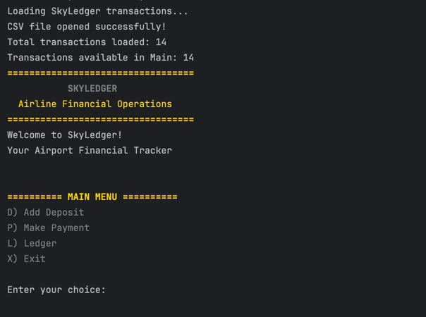

# SkyLedger – Airline Financial Operations

## Project Description

SkyLedger is a Java command-line application that helps track financial transactions for airline and airport operations.

I created this project to record deposits and payments, view transaction history, and generate financial reports. The application saves transactions in a CSV file so the information is available when the program is restarted.

## Main Features

- **Add Deposit:** Record money received from airline services.
- **Make Payment:** Record expenses such as fuel, cleaning, and maintenance.
- **View Ledger:** View all transactions, deposits, or payments.
- **Financial Reports:** View month-to-date, previous month, year-to-date, and previous year transactions.
- **Search by Vendor:** Find transactions for a specific vendor.
- **Custom Search:** Search transactions by date, description, vendor, or amount.
- **CSV File Storage:** Save and load transactions using transactions.csv.

## Technologies Used

- **Java:** Used to build the application and its features.
- **IntelliJ IDEA:** Used to write, run, and test the Java code.
- **Maven:** Used to manage the Java project.
- **CSV File:** Used to save and load financial transactions.
- **Git:** Used to track changes to the project.
- **GitHub:** Used to store and share the project online.

## How to Run the Project

1. Download or clone the project from GitHub:
   https://github.com/sumeyaabdo/accounting-ledger
2. Open IntelliJ IDEA.
3. Select **Open** and choose the `accounting-ledger` folder.
4. Wait for IntelliJ to load the Maven project.
5. Open `src/main/java/com/pluralsight/Main.java`.
6. Click the green Run button next to the `main()` method.
7. The SkyLedger main menu will appear in the console.
8. Choose an option to add deposits, make payments, view the ledger, or generate reports.

## Transaction File Storage

SkyLedger saves all financial transactions in a file named `transactions.csv`.

Each transaction includes five fields:
- Date
- Time
- Description
- Vendor
- Amount

The information is stored using this format:

`date|time|description|vendor|amount`

Deposits are saved as positive amounts, and payments are saved as negative amounts.

When the application starts, it reads the saved transactions from the CSV file. New transactions are added to the file so the information is still available after closing and reopening the application.

## Application Screenshots

Below is a screenshot of the SkyLedger main menu.

